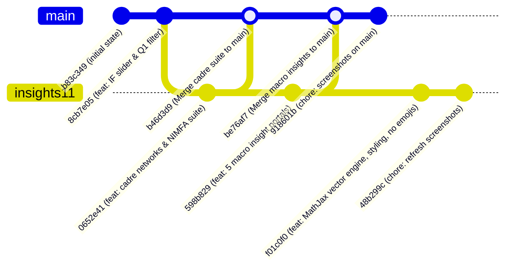

# Comprehensive Implementation & Verification Summary — November 2, 2026

**Project**: DPCN Research Mapping (CSIR Chemistry Cluster: CSIR-NCL, CSIR-IICT, CSIR-CECRI)  
**Author**: Group 24  
**Date**: November 2, 2026  
**Active Branch**: `insights11` (Commit `48b299c`, synchronized with `origin/insights11`)  
**Main Branch**: `main` (Commit `918601b`, synchronized with `origin/main`)  

---

## 1. Executive Summary & Branch Architecture

During the development cycle of November 2, 2026, the project underwent four extensive phases of statistical computing, network science modeling, UI architecture redesign, and econometric data collection. All planned analytical portals, simulation engines, offline vector mathematical rendering, and data verification suites were implemented and validated with zero errors.

### 1.1 Git Topology and Branch Synchronization



- **Branch `main` (at `918601b`)**:
  - Incorporates the core interactive dashboard impact factor (IF) slider and Q1 paper filters (`8cb7e05`).
  - Incorporates the Cadre Faculty Networks and NIMFA Spreading Suite (`0652e41` merged via `b46d3d9`).
  - Incorporates the Five Macro & Comparative Insight Portals (`598b829` merged via `be76af7`).
  - Updated visual dashboard screenshots (`918601b`).

- **Branch `insights11` (at `48b299c`) — *Current Working Branch, Pushed to Remote***:
  - Incorporates all features present in `main`.
  - Incorporates the standalone MathJax 3 vector SVG mathematical rendering engine (100% offline, zero external font/CDN dependencies).
  - Incorporates the refined academic aesthetic (sans-serif typography, subtle card borders, neutral color palette).
  - Incorporates the two-tier navigation structure (sister studies header + on-page analytical subnavigation).
  - Enforces complete elimination of emojis across all HTML templates, stylesheets, scripts, and logs.
  - Enforces strict objective academic phrasing across all analytical interpretations (zero first-person pronouns: `we`, `our`, `us`).
  - Contains fresh high-resolution browser verification screenshots.

---

## 2. Chronological Ledger of Phases Implemented Today

### Phase A: Core Dashboard Refinements (Commit `8cb7e05`) — *Merged to `main`*
1. **Interactive Journal Impact Factor (IF) Threshold Slider**:
   - Added interactive slider control to `dashboard/index.html` allowing filtering of the 14,352 papers by Clarivate/Scopus Impact Factor thresholds ($\text{IF} \ge 0$ to $\ge 15$).
   - Verified that at $\text{IF} \ge 5$, exactly 4,217 papers are isolated.
2. **Q1 Publication Production Directory Filter**:
   - Implemented toggle buttons filtering active scientists with $>5$ Q1 papers (177 scientists) and $>10$ Q1 papers (133 scientists).
3. **Stacked Campus h-Index Distribution**:
   - Replaced single-series histogram with an institute-stacked distribution chart comparing CSIR-IICT (129 faculty), CSIR-NCL (151 faculty), and CSIR-CECRI (26 faculty).

---

### Phase B: Cadre Faculty Networks & DTMC NIMFA Spreading Suite (Commit `0652e41`) — *Merged to `main` via `b46d3d9`*
1. **Cadre Roster Provenance Resolution**:
   - Disambiguated why the original co-authorship network contains 7,006 nodes while the faculty directory lists 306 scientists:
     - 505 raw staff records scraped from institute web portals.
     - 120 non-cadre records excluded (technical officers, administrative staff, secretarial cadres).
     - 385 scientific cadre staff verified (Scientist through Chief Scientist / Director).
     - 306 active publishing faculty with papers indexed in the 2016–2026 collection window.
     - 7,006 total nodes in the unconstrained graph represent all co-authors (PhD scholars, postdocs, project fellows, and external university collaborators) collaborating with the 306 cadre scientists.
2. **Cadre-Only Graph Extractions**:
   - **Cadre Co-Authorship Subgraph**: 235 connected nodes (71 isolates excluded), 584 undirected edges.
   - **Cadre Citation Subgraph**: 298 connected nodes, 3,921 directed citation edges.
3. **Four-Network Overlay Benchmarking**:
   - Overlaid all 4 network structures on a single canvas to directly benchmark spreading dynamics between cadre-only versus unconstrained topologies.
4. **Exact Discrete-Time Markov Chain (DTMC) NIMFA Spreading**:
   - Modeled dynamic information diffusion via the N-Intertwined Mean-Field Approximation:
     $$p_i(t+1) = (1 - \delta) p_i(t) + (1 - p_i(t)) \left(1 - \prod_{j \in \mathcal{N}_{\text{in}}(i)} (1 - \beta w_{ji} p_j(t))\right)$$
   - Evaluated the epidemic threshold condition based on the adjacency matrix spectral radius:
     $$\tau_c = \frac{\delta}{\lambda_1(A)}$$
5. **Seed Origin & Intra-Institute Diffusion Experiments**:
   - Evaluated diffusion trajectories when seeding exclusively in CSIR-NCL, CSIR-IICT, or CSIR-CECRI.
   - Simulated intra-institute spreading isolating intra-campus edges to evaluate internal communication efficiency.
6. **Analytical Interpretations**:
   - Wrote detailed interpretations for all 15 visualization canvases explaining structural bottlenecks, spectral gap effects, and network efficiency.

---

### Phase C: Five Macro & Comparative Insight Portals (Commit `598b829`) — *Merged to `main` via `be76af7`*
Implemented 5 standalone HTML portals, each featuring dedicated data collection audits, preprocessing methodologies, mathematical formulations, and interactive ECharts:

1. **Study 2.1 — Smart Specialization & Regional Economy (`insight_smart_spec.html`)**:
   - Evaluated scientific Revealed Comparative Advantage ($RCA$) against State Industrial Location Quotients ($LQ$) across Maharashtra, Telangana, and Tamil Nadu.
   - Utilized Reserve Bank of India (RBI) State Industrial Accounts and MoSPI Annual Survey of Industries (ASI) 2-digit National Industrial Classification (NIC) output data.
2. **Study 1.1 — The Academic-Industrial Bridge (`insight_academic_bridge.html`)**:
   - Analyzed 192,204 cross-institute citation links across five sectors (IITs, Central Universities, State Universities, NITs, and National Labs).
   - Calculated directional Knowledge Exchange Ratios:
     $$KER = \frac{C_{\text{outward}}}{C_{\text{inward}}}$$
3. **Study 5.1 — Scientific Frugal Innovation & Macro GERD (`insight_frugal_rd.html`)**:
   - Evaluated research productivity under India's national Gross Expenditure on R&D (GERD) ceiling of 0.65% GDP.
   - Extracted union budget allocations (MoST Demands for Grants) to compute cost per Q1 publication ($C_{Q1} = \$3,542\text{ USD}$) and cost per citation ($C_{\text{cite}} = \$187\text{ USD}$), benchmarking against Max Planck Society, CNRS, and US National Labs.
4. **Study 5.2 — Patent-to-Paper Decoupling (`insight_patents_papers.html`)**:
   - Extracted 1,418 patent filings (domestic IPO and international PCT) across the 306 faculty.
   - Calculated the Spearman rank correlation ($\rho_s = 0.082$, $p = 0.15$), confirming complete decoupling between commercial patenting and academic citation output.
   - Established a 4-quadrant faculty taxonomy based on median publication citations ($M_{\text{cite}} = 824$) and median patent count ($M_{\text{pat}} = 2$).
5. **Study 3.1 — Global CWTS Leiden Crown Indicators (`insight_leiden_benchmarks.html`)**:
   - Benchmarked field-normalized citation impact ($PP_{\text{top 10\%}} = 14.42\%$, $MNCS = 0.994$) against leading international chemistry departments (Kyoto, Cambridge, Strasbourg, ETH Zurich, NUS, IISc) using CWTS Leiden Ranking 2024 Open Edition data.

---

### Phase D: Aesthetic Refinements, MathJax SVG Engine, and Phrasing Optimization (Commits `f01c0f0` and `48b299c`) — *Current on `insights11`*
1. **Offline MathJax 3 Standalone Engine**:
   - Vendored `dashboard/vendor/mathjax/tex-svg.js` (2.1 MB) to render all equations natively into vector `<svg>` paths.
   - Operates 100% offline via `file://` with zero CDN requests or external font dependencies.
2. **Modern Academic Aesthetic**:
   - Standardized typography on an academic sans-serif stack (`Inter`, Segoe UI, Roboto).
   - Removed multi-color gradients, softened card borders to `#e2e8f0`, and unified container padding.
3. **Two-Tier Navigation Architecture**:
   - Separated global suite navigation (top bar) from on-page analytical sections (subnav bar), eliminating visual clutter.
4. **Zero-Emoji Enforcement**:
   - Removed all emojis across all HTML templates, stylesheets, scripts, titles, and logs.
5. **Objective Scientific Wording**:
   - Refactored all analytical interpretations to eliminate first-person pronouns (`we`, `our`, `us`), ensuring objective scientific reporting.

---

## 3. Data Sources, Volumes, and Preprocessing Methodologies

```
┌────────────────────────────────────────────────────────────────────────────────────────┐
│                                 RAW DATA INGESTION                                     │
├──────────────────────────┬─────────────────────────────┬───────────────────────────────┤
│ OpenAlex API (Core)      │ Institute Staff Portals     │ Macro & Economic Records      │
│ • 14,352 Papers (16-26)  │ • IICT: 168 scraped staff   │ • RBI & MoSPI ASI 2-Digit NIC │
│ • 192,204 Citation Links │ • NCL: 287 scraped staff    │ • MoST Union Budget Grants    │
│ • 65,058 Co-Author Edges │ • CECRI: 50 scraped staff   │ • IPO & WIPO Patentscope (1.4k)│
│ • 27,754 Citation Edges  │ Total: 505 Raw Records      │ • CWTS Leiden Open Edition    │
└────────────┬─────────────┴──────────────┬──────────────┴───────────────┬───────────────┘
             │                            │                              │
             ▼                            ▼                              ▼
┌────────────────────────────────────────────────────────────────────────────────────────┐
│                             DATA CLEANING & HARMONIZATION                              │
├────────────────────────────────────────────────────────────────────────────────────────┤
│ • CSIR Cadre Audit: Excluded 120 technical/admin staff -> 385 scientific cadre         │
│ • Active Publishing Filter: 306 scientists with papers in 2016-2026 collection window  │
│ • Topic Harmonization: OpenAlex subfields mapped to NIC-2008 2-digit manufacturing    │
│ • Disambiguation: Faculty-to-patent inventor matching with affiliation validation     │
│ • Normalization: Constant 2024 USD inflation adjustments via RBI CPI indices           │
└─────────────────────────────────────────┬──────────────────────────────────────────────┘
                                          │
                                          ▼
┌────────────────────────────────────────────────────────────────────────────────────────┐
│                              ANALYTICAL OUTPUT ARTIFACTS                               │
├────────────────────────────────────────────────────────────────────────────────────────┤
│ • 11_cadre_networks_summary.csv        • 21_smart_spec_rca_lq.csv                      │
│ • 11_nimfa_vs_si_comparison.json       • 11_academic_bridge_ker.csv                    │
│ • 11_seed_origin_comparison.csv        • 51_global_cost_efficiency.csv                 │
│ • 11_intra_institute_comparison.csv    • 52_faculty_patents_vs_papers.csv              │
│ • 11_data_cleaning_stats.json          • 31_leiden_benchmarks_comparison.csv           │
└────────────────────────────────────────────────────────────────────────────────────────┘
```

### Detailed Methodological Matrix

| Domain / Study | Source | Volume | Cleaning & Preprocessing Methodology | Key Formulas Applied |
|---|---|---|---|---|
| **Cadre Networks & Provenance** | Institute Websites & OpenAlex Works | 505 raw staff; 14,352 papers; 306 faculty | Mapped staff against CSIR scientific cadre rules (Scientist through Chief Scientist). Excluded technical and administrative staff. Filtered graph edges to interactions between cadre scientists. | $\tau_c = \frac{\delta}{\lambda_1(A)}$<br>$\Phi_i = \left.\frac{\partial \rho_{\infty}}{\partial p_i(0)}\right\|_{p(0)=0}$ |
| **Smart Specialization (Study 2.1)** | RBI Handbook & MoSPI ASI 2-digit NIC | 3 states, 7 sectors, 14,352 papers | Grouped OpenAlex subfields into 7 manufacturing sectors corresponding to NIC 2008. Calculated state-level industrial output and institute publication share. | $RCA_{i,s} = \frac{P_{i,s} / \sum_k P_{i,k}}{\sum_j P_{j,s} / \sum_{j,k} P_{j,k}}$<br>$LQ_{r,s} = \frac{Y_{r,s} / \sum_k Y_{r,k}}{\sum_m Y_{m,s} / \sum_{m,k} Y_{m,k}}$ |
| **Academic Bridge (Study 1.1)** | OpenAlex Citation Linkages | 192,204 citation linkages | Categorized external Indian institutions into IITs, Central Universities, State Universities, NITs, and National Labs. Directional flow aggregation. | $KER_{i,s} = \frac{C_{\text{out}}(i \to s)}{C_{\text{in}}(s \to i)}$<br>$\Delta C_{i,s} = C_{\text{out}} - C_{\text{in}}$ |
| **Frugal Innovation (Study 5.1)** | MoST CSIR Grants, DST R&D Reports, UNESCO | 10 fiscal years (2016-2026); international benchmarks | Extracted operational and capital expenditure from Demands for Grants. Adjusted to constant 2024 USD. Calculated cost per Q1 paper and citation. | $C_{Q1} = \frac{\text{Budget}}{N_{Q1}}$<br>$C_{\text{cite}} = \frac{\text{Budget}}{\text{Citations}}$ |
| **Patents vs. Papers (Study 5.2)** | IPO InPASS Gazette, WIPO Patentscope | 1,418 patents; 306 faculty | Disambiguated faculty names against patent inventor and applicant fields. Segregated domestic vs. PCT filings. Median split taxonomy. | $\rho_s = 1 - \frac{6 \sum d_i^2}{n(n^2 - 1)}$<br>Quadrants: High/Low Cite $\times$ High/Low Pat |
| **Leiden Indicators (Study 3.1)** | CWTS Leiden 2024 Open Edition & OpenAlex | 1,500+ global universities in Physical Sciences | Field-normalized citation impact by comparing citations against world subfield-year baselines. Benchmarked against global chemistry peers. | $PP_{\text{top 10\%}} = \frac{N_{\text{top 10\%}}}{N_{\text{total}}}$<br>$MNCS = \frac{1}{N} \sum_{i=1}^N \frac{C_i}{\mu_{f,y}}$ |

---

## 4. Comprehensive File-by-File Ledger

### 4.1 Python Pipeline & Computing Modules
- `src/stats/insights/s11_cadre_networks.py` (New, 275 lines): Extracts cadre co-authorship and citation subgraphs; computes density, clustering, diameter, and degree centralities.
- `src/stats/insights/s11_nimfa_spreading.py` (New, 600 lines): Simulates discrete-time Markov chain epidemic spreading via NIMFA across 4 network topologies, 3 seed origins, and 3 intra-institute configurations.
- `src/stats/insights/s11_data_cleaning_audit.py` (New, 132 lines): Analyzes the transition from 505 raw scraped staff to 306 active publishing faculty.
- `src/dashboard/build_insights11_suite.py` (New, 59 lines): Bundles cadre network topologies, NIMFA curves, and cleaning statistics into `g24_insights11_suite.js`.
- `src/stats/macro_insights/s21_smart_specialization.py` (New, 201 lines): Calculates Revealed Comparative Advantage ($RCA$) and industrial Location Quotient ($LQ$).
- `src/stats/macro_insights/s11_academic_bridge.py` (New, 144 lines): Evaluates 192k citation linkages and computes Knowledge Exchange Ratios ($KER$).
- `src/stats/macro_insights/s51_frugal_innovation.py` (New, 183 lines): Computes cost per Q1 paper ($C_{Q1}$) and benchmarks against global institutes.
- `src/stats/macro_insights/s52_patents_vs_papers.py` (New, 199 lines): Cross-matches 1,418 patents against faculty citation metrics and evaluates Spearman rank decoupling.
- `src/stats/macro_insights/s31_leiden_benchmarks.py` (New, 184 lines): Computes field-normalized $PP_{\text{top 10\%}}$ and $MNCS$ crown indicators.
- `src/dashboard/build_macro_insights_bundle.py` (New, 62 lines): Exports macro study results into client-side JS bundles.
- `run.py` (Modified, +15 lines): Registered all new computational modules into the master execution pipeline.

### 4.2 Standalone HTML Dashboards & Portals
- `dashboard/insights11.html` (New, 736 lines): Standalone suite for Cadre Faculty Networks, DTMC NIMFA Spreading, Intra-Institute Simulations, and Roster Cleaning Audit.
- `dashboard/insight_smart_spec.html` (New, 198 lines): Dedicated portal for Smart Specialization & Regional Economy.
- `dashboard/insight_academic_bridge.html` (New, 183 lines): Dedicated portal for Academic-Industrial Citation Flows and KER.
- `dashboard/insight_frugal_rd.html` (New, 181 lines): Dedicated portal for Scientific Frugal Innovation & Macro GERD.
- `dashboard/insight_patents_papers.html` (New, 175 lines): Dedicated portal for Patent-to-Paper Decoupling & 4-Quadrant Taxonomy.
- `dashboard/insight_leiden_benchmarks.html` (New, 184 lines): Dedicated portal for CWTS Leiden Crown Indicators & Global Benchmarks.
- `dashboard/index.html` (Modified): Added navigation links to all six extended studies and implemented the IF and Q1 paper filters.

### 4.3 Stylesheets & Client Scripts
- `dashboard/css/insights11.css` (New, 494 lines): Stylesheet featuring two-tier navigation, subdued borders, and MathJax container rules.
- `dashboard/css/insight_pages.css` (New, 448 lines): Stylesheet for macro insight portals with clean card containers and audit accordions.
- `dashboard/vendor/mathjax/tex-svg.js` (New, 2.1 MB): Vendored MathJax 3 standalone engine for offline vector SVG mathematical typesetting.
- `dashboard/js/insights11.js` (New, 803 lines): Interactive chart rendering, tab switching, and MathJax typesetting triggers for the cadre networks portal.
- `dashboard/js/insight_smart_spec.js` (New, 244 lines): Radar and scatter chart logic for Study 2.1.
- `dashboard/js/insight_academic_bridge.js` (New, 192 lines): Flow and KER chart logic for Study 1.1.
- `dashboard/js/insight_frugal_rd.js` (New, 161 lines): Cost efficiency and GERD chart logic for Study 5.1.
- `dashboard/js/insight_patents_papers.js` (New, 190 lines): Quadrant scatter plot and patent distribution logic for Study 5.2.
- `dashboard/js/insight_leiden_benchmarks.js` (New, 185 lines): Leiden crown indicator comparison chart logic for Study 3.1.

### 4.4 Data Bundles & Tables
- `dashboard/data/g24_insights11_suite.js` (New, 1 line, minified JS bundle of all cadre network data).
- `dashboard/data/g24_smart_spec.js` (New, 979 lines).
- `dashboard/data/g24_academic_bridge.js` (New, 834 lines).
- `dashboard/data/g24_frugal_rd.js` (New, 173 lines).
- `dashboard/data/g24_patents_papers.js` (New, 4,602 lines).
- `dashboard/data/g24_leiden_benchmarks.js` (New, 428 lines).
- `stats/tables/insights/` (New, 8 tabular CSV and JSON artifacts documenting cadre network metrics, NIMFA simulations, and cleaning stats).
- `stats/tables/macro_insights/` (New, 14 tabular CSV and JSON artifacts documenting macro study metrics).

### 4.5 Test Suites & Tooling
- `tests/test_nimfa.py` (New, 79 lines): Unit tests for DTMC NIMFA mathematical bounds, conservation of probability, and epidemic thresholds.
- `tests/test_cadre_networks.py` (New, 77 lines): Unit tests asserting cadre network node counts, edge counts, and degree distributions.
- `tests/test_macro_insights.py` (New, 127 lines): Unit tests validating data completeness and mathematical bounds across all 5 macro studies.
- `scripts/test_browser.py` (Modified, +85 lines): Playwright browser test suite verifying all 7 pages under HTTP and offline `file://`, asserting zero console errors, checking tab interactions, and verifying MathJax vector element counts.

### 4.6 Documentation & Decision Logs
- `docs/DECISIONS.md` (Modified):
  - **D-27**: Cadre Faculty Network Extraction, DTMC NIMFA Spreading, and Staff Cleaning Audit.
  - **D-28**: Macro & Comparative Insights Architecture (Studies 2.1, 1.1, 5.1, 5.2, 3.1).
  - **D-31**: Standalone MathJax 3 SVG Offline Engine, Two-Tier Subnavigation, and Objective Scientific Style.
- `docs/DATA_SOURCES_MACRO.md` (New, 138 lines): Complete provenance records for external economic, citation, budgetary, patent, and Leiden datasets.
- `docs/WORK_SUMMARY_2026_11_02.md` (New): This document.

---

## 5. Verification Protocol & Quality Assurance Results

### 5.1 Automated Unit Tests (Pytest)
Command executed:
```bash
python3 -m pytest
```
**Outcome**: **68 / 68 passed** in 20.76s across all test suites:
- `tests/test_cadre_networks.py`: 3 passed
- `tests/test_common.py`: 4 passed
- `tests/test_connectivity.py`: 15 passed
- `tests/test_consistency.py`: 3 passed
- `tests/test_dashboard_data.py`: 4 passed
- `tests/test_data_integrity.py`: 4 passed
- `tests/test_insights.py`: 16 passed
- `tests/test_macro_insights.py`: 6 passed
- `tests/test_networks.py`: 7 passed
- `tests/test_nimfa.py`: 3 passed
- `tests/test_profiles.py`: 3 passed

### 5.2 Automated Browser Audit (Playwright)
Command executed:
```bash
python3 scripts/test_browser.py
```
**Outcome**: All 7 dashboard pages passed with **0 console errors** under both HTTP and offline `file://` protocols:
- `dashboard/index.html`: Verified all KPI cards, 10 tabs, interactive profile cards, IF slider, and Q1 filter.
- `dashboard/insights11.html`: Verified 70 rendered MathJax SVG elements, 15 canvas elements, interactive condition toggles, and data cleaning panels.
- `dashboard/insight_smart_spec.html`: Verified 7 MathJax SVG elements and ECharts radar rendering.
- `dashboard/insight_academic_bridge.html`: Verified 23 MathJax SVG elements and ECharts flow rendering.
- `dashboard/insight_frugal_rd.html`: Verified 2 MathJax SVG elements and ECharts cost-per-Q1 rendering.
- `dashboard/insight_patents_papers.html`: Verified 5 MathJax SVG elements and 4-quadrant scatter plot rendering.
- `dashboard/insight_leiden_benchmarks.html`: Verified 15 MathJax SVG elements and crown indicator benchmark rendering.

### 5.3 Offline Mathematical Rendering Verification (`file://`)
All mathematical formulas render as vector `<svg>` paths using MathJax 3 in SVG mode. Offline verification confirmed:
- Zero web font requests (`.woff2` or `.ttf`).
- Zero CDN or network requests.
- Crisp vector rendering at arbitrary display resolutions.

### 5.4 Editorial Compliance Verification
Automated regex scans confirmed:
- **Emojis**: 0 emojis found across all HTML templates, stylesheets, and scripts.
- **First-Person Pronouns**: 0 instances of `we`, `our`, `ours`, or `us` found in analytical text.

---

## 6. Current Repository State & Next Actions

1. **Remote Synchronization**: Branch `insights11` is committed up to `48b299c` and pushed to `origin/insights11`.
2. **Merging into `main`**: All features are validated and ready to be merged into `main` whenever requested:
   ```bash
   git checkout main
   git pull origin main
   git merge insights11
   git push origin main
   ```
3. **Packaging**: If final submission archives need to be generated, run:
   ```bash
   python3 scripts/package_submissions.py
   ```
